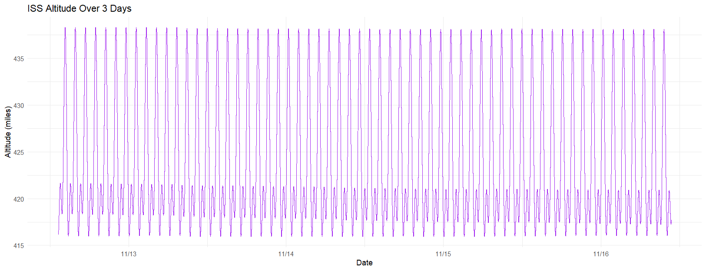
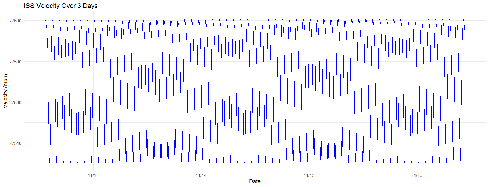

# 🛰️ Real-Time ISS Tracking and Visualisation

> Group project for TFB2093 Internet of Things at Universiti Teknologi PETRONAS (UTP), November 2025.

An IoT system that fetches the International Space Station's (ISS) live telemetry every second from the "Where The ISS At" (WTIA) API, stores it in MySQL for 3 days, and shows it on a live dashboard with a 3D globe, a flat map and an altitude chart.


## 👥 Team

| Member | Repo |
|---|---|
| Andrew Tan Joe Wen | [iot_backend](https://github.com/AndrewTJW/iot_backend), [iot_dashboard](https://github.com/AndrewTJW/iot_dashboard) |
| 'Affan Najiy bin Rusdi (me) | [iot_analysis](https://github.com/affannajiy/iot_analysis) |
| Muhammad Ikhwan bin Mohd Azahari | - |
| Muhammad Thaqif Adli bin Abdul Aziz | - |

## ⚙️ How It Works

```
WTIA API  ->  Node.js server (fetch every 1 s)  ->  MySQL  ->  REST API  ->  React dashboard
                                                       \->  CSV export  ->  RStudio analysis
```

| Section | Tools |
|---|---|
| API | WTIA |
| Server | Node.js |
| Frontend | React, r3f-globe, r3f-drei, Leaflet, Recharts, Tailwind CSS |
| Database | MySQL |
| Analysis | RStudio |

Each row stores latitude, longitude, altitude, velocity, the API's own timestamp and a `fetched_at` time from our server, so gaps and delays show up when comparing the two. 1 sample per second for 3 days is up to 259,200 rows.

## 📊 Results

Data collected over 3 days from 12 November 2025.

| | Min | Max | Average |
|---|---|---|---|
| Altitude | 415.9 | 438.3 | 424.1 |
| Velocity | 27,530 | 27,601 | 27,573 |

> The report labels these as miles and mph, but the values match km and km/h (the ISS flies at about 400 to 420 km and about 27,600 km/h).

| Altitude | Velocity |
|---|---|
|  |  |


## 💰 Cost

RM0.00. Every tool was free and everything ran locally. Next step would be hosting on Render or AWS.

## 🚧 Limitations

- WTIA allows 1 request per second, so any network delay leaves gaps.
- Storage keeps growing; a longer run would need a more scalable database.
- Altitude accuracy depends on API rounding and latency.

## 📁 Files

| File | What it is |
|---|---|
| `IoT_ISS Telemetry.docx` | Full project report |
| `Dashboard Globe.png`, `Dashboard Map.png` | Dashboard screenshots |
| `LineChart_*.png`, `ISS_Path_13Nov_Report.png` | Analysis charts from RStudio |
| `ISS Image.jpg` | Figure 1 of the report |
| `Video/` | Backend, dashboard code, dashboard page demos and the presentation |
| `*.pdf` | Reference papers (see below) |

## 🔗 References

1. L. E. Warren, "International Space Station open-source data," _Patterns_, vol. 1, no. 9, 2020.
2. C. A. Evans, J. A. Robinson and J. M. Tate-Brown, "Research on the International Space Station: An overview," AIAA Space 2009.
3. J. Newland, "A simple model to determine the altitude and velocity of the I.S.S.," University of Houston, 2016.
4. B. Shump, [Where the ISS At? API Documentation](https://wheretheiss.at).

📺 [Video presentation on YouTube](https://www.youtube.com/watch?v=tsH1vv8k8K8)
